<p align="center">
  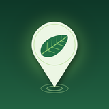
</p>

<h1 align="center">Autrey Mill Sentry</h1>

<p align="center"><b>Every visitor becomes a sentry for the preserve.</b><br>
A native iOS app that spots invasive plants on the trails of Autrey Mill Nature Preserve (Johns Creek, Georgia), verifies them on the phone, puts them on a ranked map for staff, and tells the reporter when the patch is treated.</p>

<p align="center">
  
  
  
  
  
</p>

<p align="center">
  
  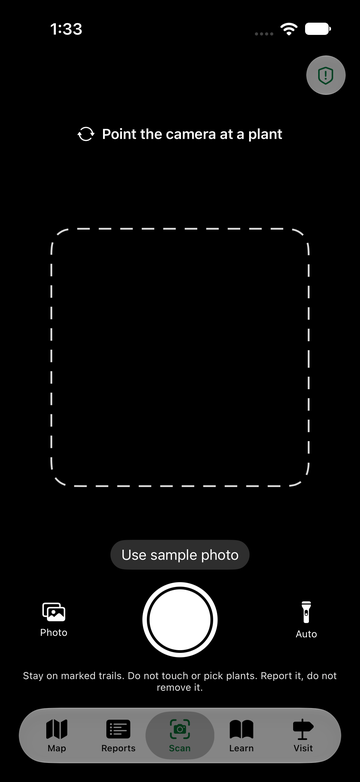
  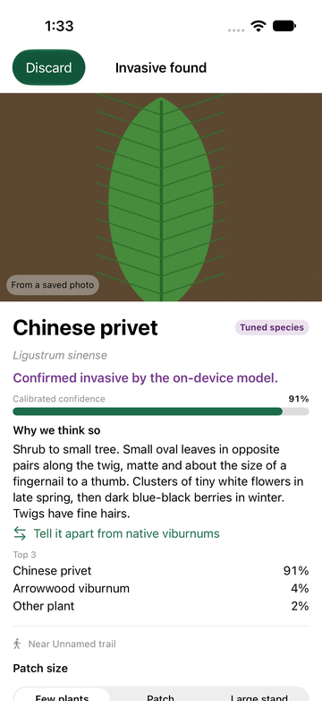
  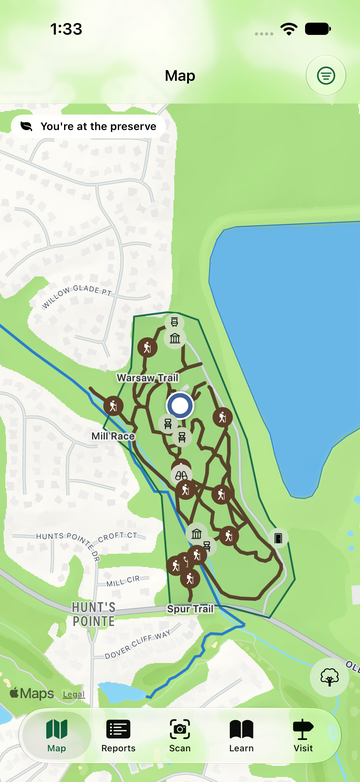
  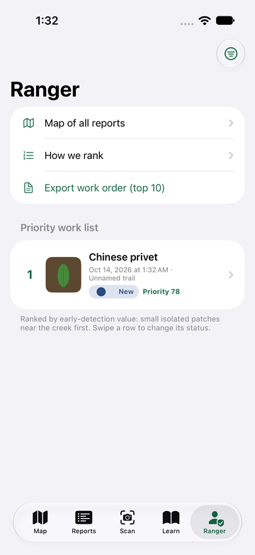
  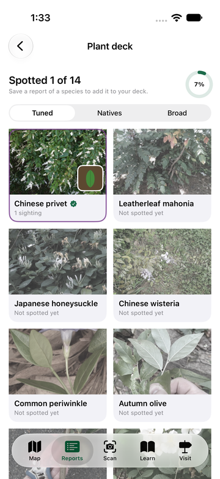
</p>

> Built by a student team for the 2026 Congressional App Challenge. Autrey Mill Nature Preserve & Heritage Center has not endorsed or approved it. Every number in this file comes from an evaluation file in `model/eval/`; nothing is estimated.

---

## The problem

Autrey Mill is 46 acres of Piedmont forest and creek inside a suburb. The preserve's own volunteers list fourteen invasive plants on the property: Chinese privet, English ivy, Japanese honeysuckle, Chinese wisteria, kudzu, mimosa, nandina and more. Small patches are cheap to remove and big ones are not, so the whole game is early detection, and a small staff cannot walk every trail every week. Thousands of visitors already do.

## The loop: Spot, Verify, Act, Tell

| | What happens | Where in the code |
|---|---|---|
| **Spot** | Live camera at about 4 frames per second with guidance ("Move closer to the leaves", "Hold steady", "Too dark, find some light"), auto flashlight, tap to focus. The model looks at the whole frame and at the region Vision finds salient, and must agree on 5 of the last 8 frames before it says **locked on**. | [`Scanner/ScanViewModel.swift`](AutreyMillSentry/Scanner/ScanViewModel.swift), [`Scanner/CameraService.swift`](AutreyMillSentry/Scanner/CameraService.swift), [`LockOnTracker`](AutreyMillSentry/Scanner/ScanDecision.swift#L285) |
| **Verify** | Two Core ML models average five views of the captured still. Exactly one of four outcomes: **confirmed invasive**, **possible invasive (expert review)**, **looks native**, or **rescan** with a specific reason. An embedding similarity gate downgrades calls that sit far from the species' training photos. | [`ScanDecision.decideRaw`](AutreyMillSentry/Scanner/ScanDecision.swift#L157), [`Scanner/EnsembleClassifier.swift`](AutreyMillSentry/Scanner/EnsembleClassifier.swift), [`Scanner/Embeddings.swift`](AutreyMillSentry/Scanner/Embeddings.swift) |
| **Act** | Reports land on a real map of the preserve (OpenStreetMap trails, boundary, Sal's Creek) and on a transparent early-detection rank: small, isolated, near the creek, recent, aggressive spreader. One tap sends them to the staff dashboard. | [`Ranger/PriorityScore.swift`](AutreyMillSentry/Ranger/PriorityScore.swift#L25), [`Map/MapScreen.swift`](AutreyMillSentry/Map/MapScreen.swift), [`Services/DashboardSync.swift`](AutreyMillSentry/Services/DashboardSync.swift) |
| **Tell** | When staff mark a report treated on the dashboard, the app learns it on its next check and the reporter gets a notification. | [`dashboard/app/api/reports/[id]/status/route.ts`](dashboard/app/api/reports/%5Bid%5D/status/route.ts), [`Services/DashboardSync.swift`](AutreyMillSentry/Services/DashboardSync.swift) |

<p align="center">
  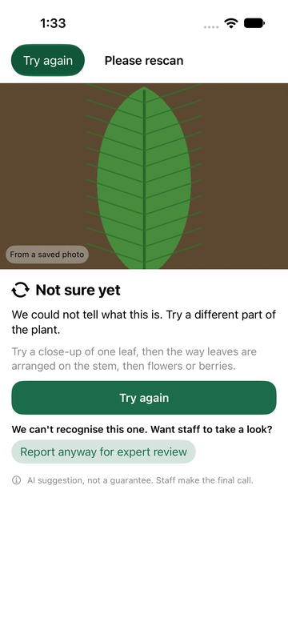
  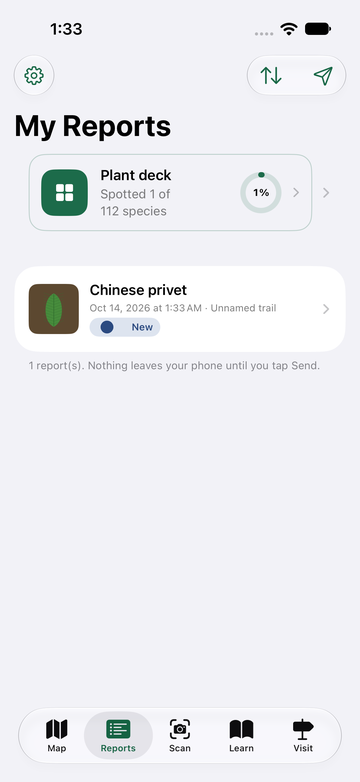
  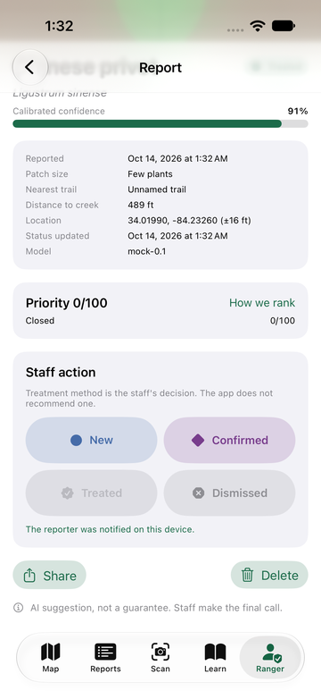
  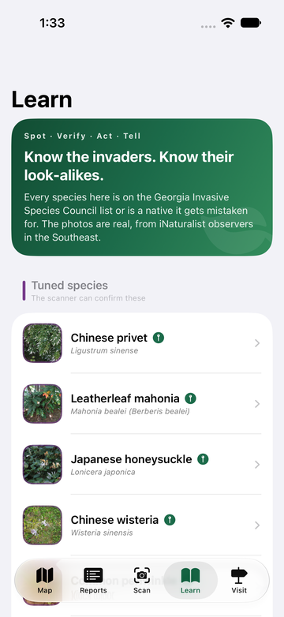
  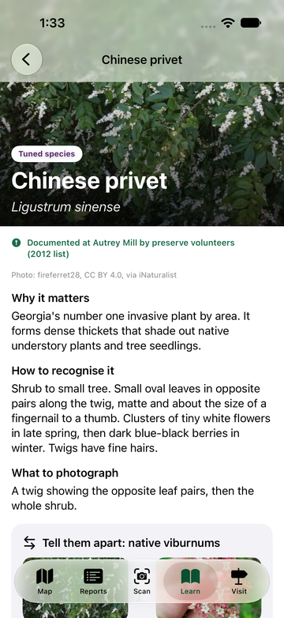
  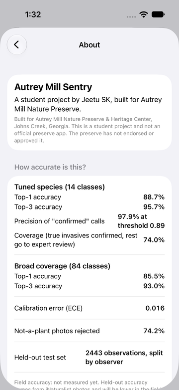
</p>

## How the scanner works

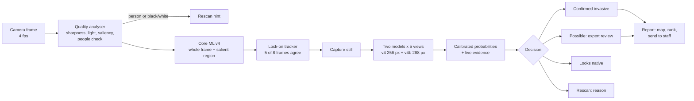

- **Confirmed** needs a tuned (Tier 1) species on top, a calibrated probability above that species' own floor (0.75 to 0.97, tuned on validation), a 0.30 margin over the runner-up, low entropy, and a photo inside the species' similarity radius.
- **Natives are first-class.** 88 native plants are named classes, 74 of them the most-observed species within 4 km of the preserve on iNaturalist, so a sweetgum is called a sweetgum instead of becoming a weak invasive guess. When two look-alike natives split the vote, their combined mass still reads as native.
- **Trained for the trail.** The models were trained with dusk and sensor noise, flashlight vignettes, backlight, dappled canopy light, hand-shake blur, far-away subjects and low resolution, because the first field test failed in the shade.

<p align="center">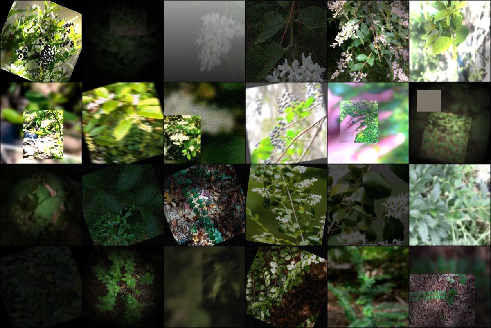</p>

## The model, measured honestly

Two EfficientNet-B0 networks (256 px and 288 px, different seeds) trained with PyTorch on an Apple M5 Pro, exported to Core ML, averaged on the captured still. Data: **62,041 iNaturalist research-grade photos** under CC0, CC BY and CC BY-NC licences, **186 species** plus "other plant" and "not a plant", split **by photographer** (8,040 / 907 / 1,028 observers for train / validation / test) so one person's near-duplicate shots can never leak between training and test. Full details in [`docs/MODEL_CARD.md`](docs/MODEL_CARD.md).

| Held-out test, 5,896 photos | Ensemble |
|---|---|
| Top-1 / top-3 accuracy, 188 classes | **84.4% / 92.4%** |
| Tier 1 invasives (the 14 the app can confirm) | 88.5% |
| Natives known by name (88) | 87.0% |
| Precision of "confirmed invasive" calls | **97.5%** at 66.5% coverage |
| Natives wrongly flagged as invasive | 1.9% |
| Other wild plants wrongly flagged | 9.8% |
| True invasives flagged (confirmed or possible) | 86.0% |

**Trail conditions.** The same test photos degraded the way a phone sees plants on the trail, scored by [`model/field_eval.py`](model/field_eval.py). The first shipped model versus the current ensemble:

| Condition | v3 (Oct 14) | v4 + v4b (Oct 20) |
|---|---|---|
| Clean | 87.6% | 87.4% |
| Dusk with sensor noise | 10.3% | **78.7%** |
| Flashlight at night | 73.0% | 86.9% |
| Backlit | 84.9% | 86.3% |
| Dappled canopy light | 85.3% | 86.5% |
| Hand-shake blur | 49.3% | **80.5%** |
| Out of focus | 69.9% | 80.4% |
| Far-away subject | 33.6% | **74.5%** (78.1% with the app's focus crop) |
| Low resolution | 74.4% | 82.0% |
| Mean over 16 degradations | 71.5% | **83.0%** |

**The preserve's own plants.** On 1,500 held-out photos of the 74 common natives nearby, the first model said "native, nothing to report" 34% of the time and flagged 16% as possible invasives. The current ensemble says native **94.7%** of the time, flags **1.1%**, and names the exact species correctly 87.6% of the time (`model/eval/local_natives_*.json`).

Calibration: temperature scaling and the per-species confirm floors are fitted on clean **and** degraded validation photos, so the confidence bar means the same thing in the shade as in the sun (expected calibration error 0.011 on clean test, 0.023 on degraded test).

## The staff dashboard

Any ranger can open the link, no account. Reports arrive within seconds of **Send**, ranked by the same score as the app, on a map with the preserve's trails and creek. Four big status buttons, CSV export, delete. Built with Next.js on Vercel's free tier, photos in a private Blob store, EXIF stripped before upload, no identity anywhere.

<p align="center">
  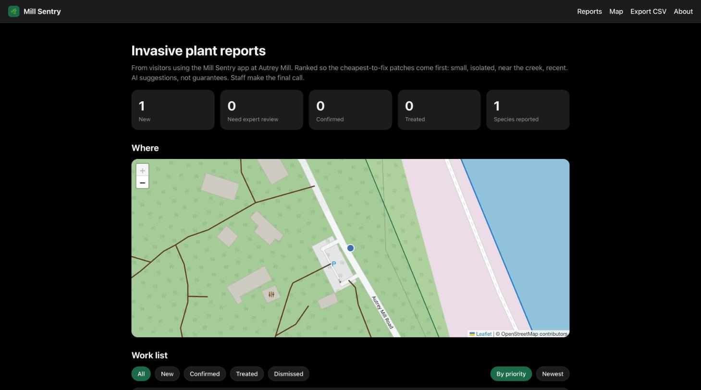
  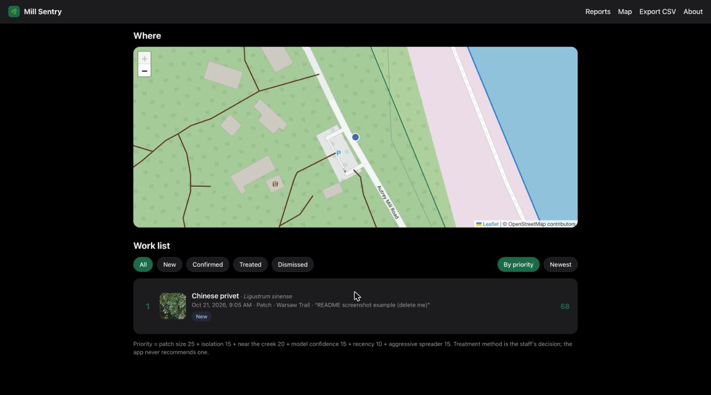
</p>

## Design and accessibility

Apple HIG throughout: tab bar with Scan in the middle, 44 pt hit targets, Dynamic Type up to the largest accessibility size, VoiceOver labels on pins and badges, shape-plus-colour status pins, dark mode, Reduce Motion aware animations, a forest-green launch sequence. Verified with Xcode's accessibility audit and screenshot walkthroughs on four device configurations ([`docs/DESIGN_CHECKLIST.md`](docs/DESIGN_CHECKLIST.md)).

<p align="center">
  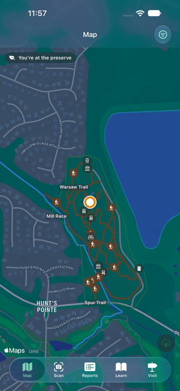
  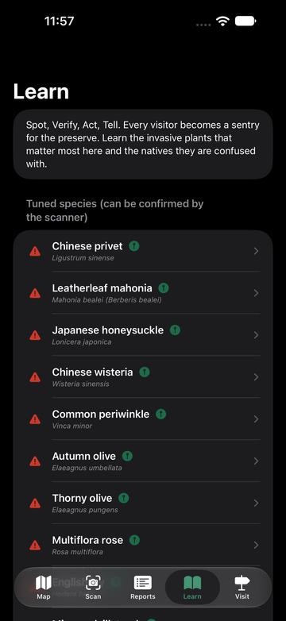
  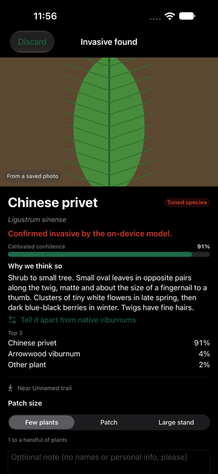
  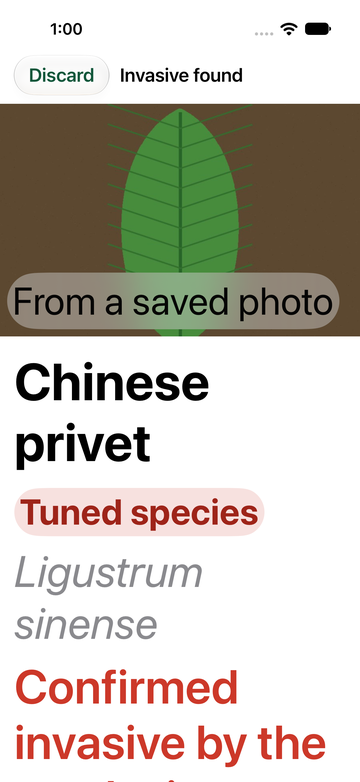
  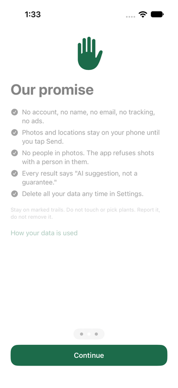
</p>

## Privacy and honesty by design

- No accounts, no analytics, no third-party SDKs. Camera and When-In-Use location only, asked at the moment of need.
- Photos are stored without EXIF. Shots with people are refused before capture.
- Nothing leaves the phone until the visitor taps Send. Delete everything in one tap.
- Every result says "AI suggestion, not a guarantee". The About screen shows only measured numbers and says "field accuracy: not measured yet" until a field test CSV exists ([`docs/PRIVACY.md`](docs/PRIVACY.md), [`docs/FIELD_TEST_GUIDE.md`](docs/FIELD_TEST_GUIDE.md)).

## Repository map

```
AutreyMillSentry/           iOS app (Swift, SwiftUI)        5,400 lines
  App/        Config, AppModel, root tabs, launch overlay
  Scanner/    camera, quality gates, Core ML, decision, lock-on, result screen
  Map/        MapKit map with bundled OSM trails, boundary, creek, pins
  Reports/    SwiftData store, list, detail, export, plant deck
  Ranger/     priority score, work list, work-order PDF
  Learn/      species pages, 186 photos with iNaturalist credits
  Services/   location, geofence, notifications, dashboard sync
  Resources/  two Core ML models, labels, thresholds, embeddings, GeoJSON, species JSON
AutreyMillSentryTests/      75 unit tests (decision, lock-on, rank, geometry, store, real Core ML)
AutreyMillSentryUITests/    happy path, screenshot walkthroughs, accessibility audit
model/                      training pipeline (Python, 2,200 lines with tools/): train, evaluate,
                            calibrate, embeddings, Core ML export, field-conditions eval, comparison
tools/                      iNaturalist fetch, map clipping, Learn photo picker, device install
dashboard/                  staff site (TypeScript, Next.js, Vercel Blob)   1,100 lines
docs/                       model card, privacy, ranking, sources, licences, map, dashboard
```

Start with [`docs/README.md`](docs/README.md) for the document index.

## Build and run

Requirements: Xcode 16 or newer, a free Apple ID for device signing, an iPhone on iOS 17 or newer (the camera needs a device; the Simulator runs everything else through the photo-picker button).

```bash
open AutreyMillSentry.xcodeproj
```

Set **Signing & Capabilities > Team** to your personal team, pick your phone, Run. From the command line:

```bash
tools/build_sim.sh test          # 75 unit tests on the iPhone 17 simulator
tools/install_when_connected.sh  # build, sign and install on a connected iPhone
```

Launch arguments for automation: `-uiTesting -skipOnboarding -mockScan confirmed|possible|native|ambiguous|notplant -simulateLocation -rangerMode`.

Retraining (free, on a Mac): `tools/fetch_inat.py` builds the licensed dataset, `tools/run_training_chain_v4.sh` trains and evaluates, `tools/bundle_model_v4.sh` puts the models, thresholds, centroids and model card into the app.

## Credits

Map data © OpenStreetMap contributors (ODbL). Base map © Apple Maps. Training photos by iNaturalist observers under CC0, CC BY and CC BY-NC, credited by name in [`docs/LICENSES.md`](docs/LICENSES.md); no training photo is redistributed. Species status from the Georgia Invasive Species Council list; preserve species from the Autrey Mill volunteer post of 2012; ranking weights from the Georgia Forestry Commission Dirty Dozen ([`docs/SOURCES.md`](docs/SOURCES.md)).
